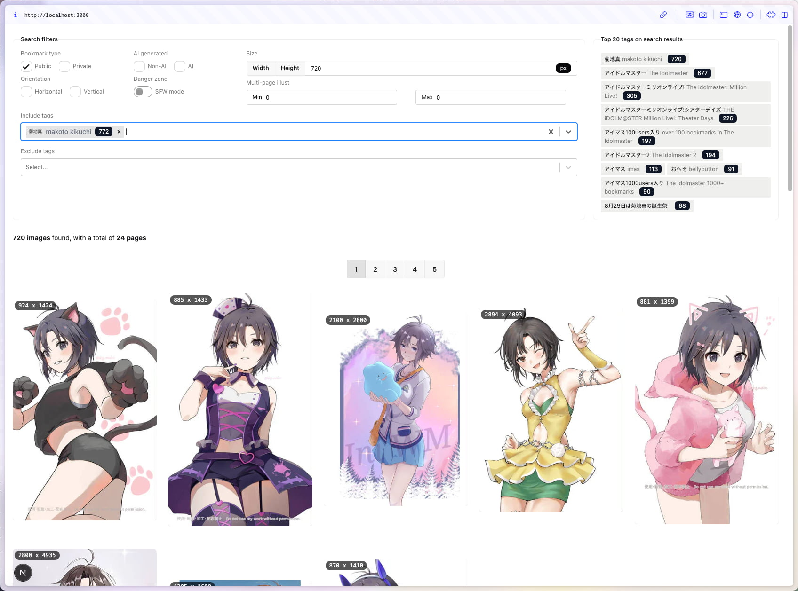

pixiv Bookmarks Visualizer
===

Performing complex search with your pixiv bookmarks.

The application uses TanStack Start 1.169.1, TanStack Router 1.170.44, React 19.3.0, and Vite 8.3.4. Versions are pinned in `package.json` and `bun.lock`. Bun 1.4.3 or newer is required for the application and SQLite scripts. Node 22.12 or newer is supported by the build tools; the application itself runs on Bun because its database driver uses `bun:sqlite`.

The migration follows the current [Start Vite setup](https://tanstack.com/start/latest/docs/framework/react/build-from-scratch) and [Bun hosting guide](https://tanstack.com/start/latest/docs/framework/react/guide/hosting). `vite.config.ts` retains the `app/` source directory and `$` import aliases. Start generates the route tree and supplies its default client/server entries. API URLs and JSON shapes remain compatible.



Features
---

- Filter illusts by bookmakrs type (Public / Private)
- Search illust by tags, serch query can be both in Japanese, and English
- Filter illusts by orientation (Vertical / Horizontal). Great use when looking for new desktop or mobile wallpaper.
- Filter illusts by minimum pixel resolution on either axis (Width / Height)
- Actual resolution indicator on top-left corner of each illusts.
- Include and exclude multiple tags, with contextual tag suggestions and top-tag counts.
- Filter AI-generated illustrations and minimum/maximum page counts.
- Save filters and pagination in the URL; restore them on reload and browser navigation.
- SFW mode blurs private and R-18 illustrations; ugoira animates on hover when its converted cache exists.

Preload data
---

> [!NOTE]
> Our backend engine are now using SQLite to store all of your bookmarks' data. This will reduce the time to load all of your bookmarks data into memory, and also reduce the time to search for specific illusts.
> This may have performance degradation for HDD users.

> [!WARNING]
> This project is only built for running locally, please do not deploy to public internet otherwise it might not be working properly, or all of your private bookmarks will be public

First, you have to get your account refresh token in any mean nessesary. I recommend [this script](https://github.com/eggplants/get-pixivpy-token) to obtain refresh token.

Then, make your own `.env` file based on `.env.example` by providing refresh token and your user ID into the file.

```
cp .env.example .env
```

After that, install dependencies reqired for this project and run a script to obtain all of your bookmarks. Script will take a while to scrape data, depending on how much bookmarks in your account.

```
bun i
bun db:init
bun build:data
```

Optionally, you can pre-download **all** illusts into local machine right away to reduce frist-load image time in browser. Each image will consume avarage of *40KB* of storage (minimum 10KB, maximum ~100KB). To do this run following command.

```
bun build:image
```

Pixiv CDN may not prepared you to access very old illusts which could cause some preload image to fail. Just running preload command continuously until no any `fail: ` emit into output.

Notes for うごイラ illusts
---

By default this web app will not try to display image as gifs since it take a lot of time to response back. If you want *うごイラ* illusts to be animated run following command to generated (somewhat) highly optimized animated WebP.

```
bun build:ugoira
```

Also, [`img2webp`](https://developers.google.com/speed/webp/docs/img2webp) is required. Install on your macOS by running `brew install webp`

Script expected to fail multiple times since there's a rate limit on Pixiv API. Wait for about 3-5 minutes for rate limit quota to refill and run the script again until scripts finished without any errors.

Spin-up a server
---

As I said, you should be aware of where did you run this server on. Running this application in public network could compromise your private bookmarks.

There're 3 method to start a server, but I do prefer a thrid method

### Method 1: Start as development server

```
bun dev
```

### Method 2: Start as production server (less pre-compile time)

```
bun run build
bun run start
```

Vite builds `dist/client` and `dist/server`. `server.ts` serves static assets and forwards SSR/API requests to Start's generated fetch handler using Bun. Keep `dist/`, `server.ts`, and the installed production dependencies together. `PORT` defaults to `3000`; `HOST` defaults to `0.0.0.0`.

`DB_FILE_NAME` still selects the SQLite database. Images and converted animations still use `.data/pixivProxy` and `.data/ugoiraProxy`. Set `PIXIV_DATA_DIR` only to override the image-cache base directory; it does not change the database path. Existing databases require no new migration or data fetch for this framework upgrade.

### Method 3: Start as container service

```
docker-compose up -d
```

Acceptance testing
---

Install the pinned dependencies and browser binaries:

```
bun install --frozen-lockfile
bun run --bun playwright install chromium firefox webkit
```

Run the complete gate:

```
bun run lint
bun run type-check
bun run test:unit
bun run test:e2e
bun run test:e2e:dev
```

`test:e2e` builds and tests the production Bun server. `test:e2e:dev` exercises the same contract against Vite's development server. Chromium, Firefox, WebKit, and a mobile Chromium viewport cover SSR, hydration/console health, bookmark/orientation/size/AI/page-count filters, translated and Japanese tag search, include/exclude tags, top tags, pagination/history, saved URLs, SFW blur, multi-page images, and ugoira delivery. Hover tests intentionally skip the touch-only mobile project.

Tests create a fresh SQLite database from the existing Drizzle migration and populate synthetic illustrations plus static/animated WebP caches in an OS temporary directory. They call the real API routes. No Pixiv token or account data is required, and tests neither read nor write your `.data` directory. Ports `4173` (production) and `4174` (development) must be free; tests deliberately refuse to reuse an existing server.

Screenshots and failure traces are saved under the OS temporary directory in `pixiv-start-acceptance-production` or `pixiv-start-acceptance-development`. For a focused run after building:

```
bun run --bun playwright test --project=chromium
```

The acceptance suite also guards fixes discovered during migration: orientation compares dimensions directly instead of SQLite integer division; AI switches select their stated class; URL state is shared through the router instead of competing per-component synchronization timers; tag metadata refresh cannot block or undo a selection change; asynchronous API failures retain their JSON error envelope; unsupported API methods return `405` instead of an HTML page. React Select 5.10.2 includes the upstream fix for platform-dependent SSR hydration attributes on macOS.
